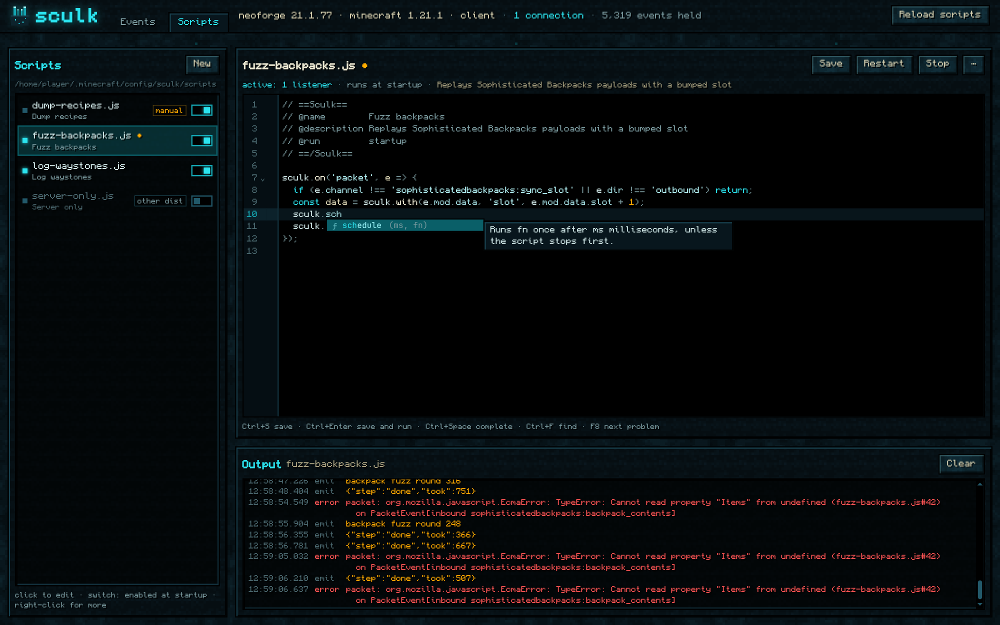

# sculk

A scriptable intercepting proxy for modded Minecraft, running inside the game.
It is for finding and reproducing protocol-level security bugs in mods.

Sculk captures, decodes, edits and injects game traffic, vanilla and modded,
and says which mod each packet belongs to. It decodes mod payloads with each
mod's own codec, and everything is scriptable in JavaScript. It runs on the
**client** (malicious client against server-side mods) and on the **server**
(malicious server against client-side mods).

Only use it against clients and servers you own or are authorised to test.

See [docs/ARCHITECTURE.md](docs/ARCHITECTURE.md) for goals, design and roadmap.

## Status

Early, but working on every target below: capture, drop, replace and inject
frames and packets in both directions on both sides; attribute payloads to
the mod that owns them; decode them with the mod's own codec; script all of
it in JavaScript; and drive it live from a local control server (CLI, web UI,
MCP). Unit, smoke and real-mod integration tests cover each target. See the
roadmap in [docs/ARCHITECTURE.md](docs/ARCHITECTURE.md#roadmap) for what is
next.

| Target | Loader | Minecraft | Java | Why |
|---|---|---|---|---|
| `platforms/forge-1.18.2` | Forge 40 | 1.18.2 | 17 | long-lived modpack version |
| `platforms/forge-1.19.2` | Forge 43 | 1.19.2 | 17 | long-lived modpack version |
| `platforms/forge-1.20.1` | Forge 47 | 1.20.1 | 17 | largest modpack install base |
| `platforms/neoforge-1.21.1` | NeoForge 21.1 | 1.21.1 | 21 | largest active mod ecosystem |
| `platforms/fabric-1.21.1` | Fabric 0.20 | 1.21.1 | 21 | the same mods' Fabric builds; intermediary names |
| `platforms/fabric-26.3` | Fabric 0.20 | 26.3 | 25 | latest release, unobfuscated |
| `platforms/neoforge-26.3` | NeoForge 26.3 | 26.3 | 25 | latest release on NeoForge |

## Web UI

`scripts/sculkctl.py ui`, or `/sculk ui` in game, opens a web UI onto the
running game. Agents get the same over MCP.


**Events.** Watch every packet live or scroll back through the whole session,
with Wireshark-style filters. Mod payloads are decoded with the mod's own
codec, next to the raw bytes. Right-click to replay a packet or drop ones like
it.

**In game.** `/sculk` works from chat:

| Command | |
|---|---|
| `/sculk mark <description>` | drops a `mark` event into the stream at that moment; its reply's **[show]** opens the web UI there |
| `/sculk script list` | the installed scripts and their state |
| `/sculk script run <name>`, `stop <name>` | start or stop one (tab completes the names) |
| `/sculk script reload` | restart all scripts from disk |
| `/sculk mcp list`, `accept [n]`, `revoke <n>` | approve MCP clients that connect without the token (see below) |
| `/sculk mcp token` | print the control token in chat |
| `/sculk ui [event]` | open the web UI in your browser, signed in, at that event if given (game clients only) |

In a game client these are client commands, so they work on any server; a
dedicated server offers them to operators.



**Scripts.** Write, run and toggle JavaScript in the game, with completions
and live output. Scripts sit in `config/sculk/scripts/`, so a modpack can
ship them.

## Development

Everything you need (Gradle, JDK 17/21/25, client native libraries) comes from
the Nix flake:

```sh
nix develop            # or: direnv allow
gradle build           # all targets; jars in platforms/*/build/libs/
gradle :core:test      # engine unit tests, no Minecraft needed

gradle :platforms:neoforge-1.21.1:runClient
gradle :platforms:neoforge-1.21.1:runServer

scripts/smoke-server.sh forge-1.20.1   # boot a server, connect, check the hook fired
scripts/integ.py fabric-1.21.1         # real server + headless client + real mods + sculk's test mod

# control server: query and tail events, run code in the live game
gradle :platforms:neoforge-1.21.1:runServer -Psculk.control=0
scripts/sculkctl.py tail 'kind == packet && owner != minecraft'
scripts/sculkctl.py repl
scripts/sculkctl.py ui              # the web UI, signed in
scripts/sculkctl.py mcp-config      # connect an MCP client (e.g. Claude Code) to the live game
```

MCP clients pair instead of holding the token: add the server once, with a
fixed port (`-Psculk.control=25580`), and when the agent first calls a tool
it asks you to type `/sculk mcp accept <n>` in game (sculk also says so in
your chat, with an **[accept]** button). Approval lasts until the
game exits; after a restart the client reconnects and asks again, with no
change to its configuration.

`gradle build` also runs `nix build .#web` for the control server's web UI
(`web/`); pass `-Psculk.webDir=<dir>` to use a prebuilt one instead.

To work on the web UI without Minecraft, run `web/tools/mock-server.py`: it
serves the UI from source (rebuilt on reload) against a made-up game.

The first build of each target downloads and decompiles Minecraft and takes a
few minutes.

Without Nix: install Gradle 9.8+ and JDKs 17, 21 and 25, and export
`JAVA17_HOME`, `JAVA21_HOME` and `JAVA25_HOME`. The build never auto-downloads
toolchains.

## Layout

```
core/         shared engine, no Minecraft dependencies (~90% of the code, eventually)
libs/         third-party libraries, relocated so they cannot clash with other mods
platforms/    one thin adapter per (loader, Minecraft version); shared/ holds game code
              common to every loader of one version, and the integration test mod
scripts/      dev tooling
web/          control server web UI (TypeScript, built by Nix)
docs/         architecture and design notes
```
